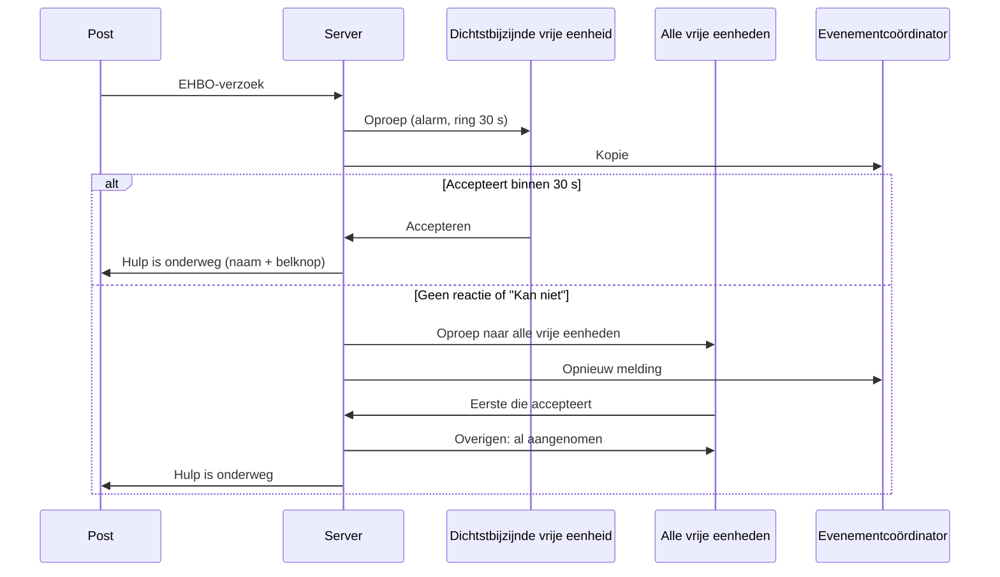
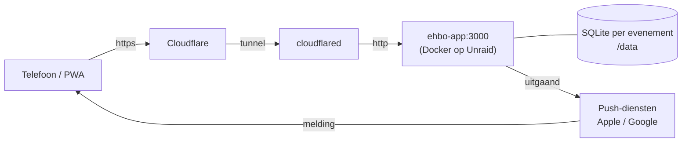
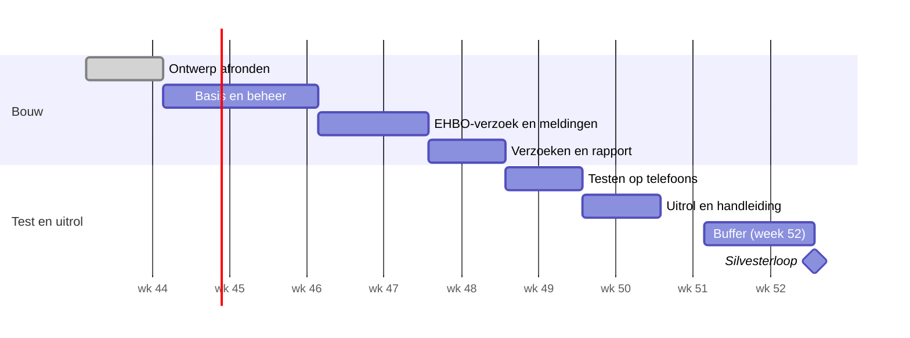

# EHBO Evenementen-app – Functioneel ontwerp

28 oktober 2026 · Martin Groeneveld · bron: [Claude-document](https://claude.ai/artifact/9kPLdEtjhEQidDnbRnipmU)

Bijbehorend: het schermontwerp in [`design/`](design/index.html) (origineel: [artifact](https://claude.ai/artifact/VK6w9wwvti59R6Pu57nGKZ)) met alle schermen op volgorde van het proces (1.1 voorbereiding t/m 6.1 rapport). Dit document beschrijft de werking; het schermontwerp laat zien hoe het eruitziet.

## Doel en uitgangspunten

De app brengt bij een hulpvraag op een post binnen enkele seconden de dichtstbijzijnde EHBO'er in actie, en geeft iedere medewerker het volledige overzicht om elkaar te bellen of naar elkaar toe te rijden. Eerste inzet: de Silvesterloop Poppenwier op donderdag 31 december 2026, met een Kidsrun en 5, 10 en 21 km lopen en wandelen, start bij Eetcafé De Trilker en honderden deelnemers (ca. 15 posten, 20 medewerkers, 2–3 EHBO-eenheden). De opzet is modulair, zodat dezelfde app ook een groot evenement aankan.

- **Tijdelijk en ondersteunend.** De app vervangt 112 niet. Bij levensgevaar bel je eerst 112; die knop staat op elk scherm.
- **Simpel.** Geen accounts of wachtwoorden. Medewerkers melden zich aan met hun eigen telefoonnummer.
- **Altijd bruikbaar.** Er is overal 4G/5G. De app praat met een eigen server, maar kaart, contacten, bellen en navigeren werken ook zonder bereik.
- **Als een echte app.** Een webapp (PWA) op een eigen subdomein, die verplicht op het beginscherm wordt gezet. Geen app store nodig.
- **Iedereen ziet alles.** Elke medewerker ziet alle posten en contactgegevens. Deelnemers zien alleen de route, de posten en de starttijden.

## Rollen en rechten

Eén persoon kan meerdere rollen hebben (bijv. beheerder én EHBO'er). De rol volgt uit het telefoonnummer: wie bij een post of functie staat, is medewerker; wie op de beheerderslijst staat, is beheerder.

| Rol | Wie | Ziet | Kan |
| --- | --- | --- | --- |
| Deelnemer | Iedereen zonder aanmelding | Route, posten (zonder namen/nummers), starttijden met favoriete loop bovenaan, info-pagina | 112 bellen |
| Medewerker / posthouder | Telefoonnummer staat bij een post | Alles: alle posten, contacten, kernteam, noodnummers | Bellen, navigeren, verzoeken doen vanaf de eigen post; postverantwoordelijke zet de post open of dicht |
| EHBO'er | Telefoonnummer staat bij een EHBO-post of -eenheid | Als medewerker | Oproepen ontvangen, accepteren/weigeren, incident afronden |
| Kernteam | Functie zonder vaste post (evenementcoördinator, wedstrijdleiding, …) | Als medewerker, staat bovenaan het overzicht | Evenementcoördinator: ontvangt alle verzoeken en een kopie van elke EHBO-oproep |
| Beheerder | Staat op de beheerderslijst | Als medewerker + beheerscherm | Evenement instellen, posten en personen beheren, elke post open/dicht zetten, beheerders toevoegen/verwijderen, rapport maken |

**Beheerderslijst.** Een losse lijst telefoonnummers. Toevoegen en verwijderen kan door elke beheerder. Je eigen nummer kun je niet verwijderen, zodat er altijd minstens één beheerder overblijft. De eerste beheerder wordt bij de installatie op de server ingesteld.

## Installatie en aanmelden

Elk evenement krijgt een eigen adres (bijv. silvesterloop.groveld.com). Deelnemers en gasten kijken direct mee; medewerkers zetten de app eerst op hun beginscherm en melden zich aan met hun telefoonnummer.

1. **Link of QR-code openen** op het adres van het evenement.
2. **Keuzescherm:** *Medewerker / vrijwilliger* of *Deelnemer / gast*.
3. **Deelnemer / gast** gaat direct door naar route, posten en tijden. Geen installatie, geen aanmelding, geen persoonsgegevens.
4. **Medewerker** zet eerst de app op het beginscherm (verplicht, nodig voor meldingen). De app herkent het toestel: iPhone krijgt stap-voor-stap uitleg, Android één knop *Installeren*.
5. **Telefoonnummer invullen** (06 of +31 wordt gelijk getrokken).
   - Bekend nummer → naam, functie(s), post(en) en tijden ter bevestiging. Meerdere plekken → kiezen waar je nu bent; wisselen kan later.
   - Onbekend nummer → opnieuw proberen, de evenementcoördinator bellen, of door als gast.
6. **Eerste keer:** info & voorwaarden bevestigen, daarna toestemming voor meldingen en locatie.
7. **Ingelogd.** Het beginscherm volgt de belangrijkste rol van het nummer:
   - beheerder of kernteam → overzicht met kaart en open oproepen (de evenementcoördinator ook de wachtrij met verzoeken);
   - EHBO'er → stand-by met oproepen;
   - postverantwoordelijke → de eigen post: eerst post openen, daarna de verzoek-tegels;
   - overige medewerkers → overzicht.

   Via het menu kan iedereen altijd naar het overzicht. Aangemeld blijven tot het einde van het evenement.

**Beveiliging, nu en later.** In de eerste versie is het nummer een identificatie, geen beveiliging: wie het nummer van een collega kent, kan zich zo aanmelden. Elke aanmelding komt wel in het logboek (tijd, toestel). Later komt er een verificatie met een sms-code bij de eerste aanmelding op een toestel. De aanmeldstap is daar al op voorbereid: de code wordt een extra stap tussen *nummer invullen* en *bevestigen*, zonder dat de rest verandert.

## Posten, medewerkers en vaste gegevens

Medewerkers ontstaan vanzelf: wie je als contact bij een post of functie zet, kan met dat nummer inloggen. Een aparte personeelslijst of Excel is niet nodig. Omwisselen tijdens het evenement = het nummer bij de post aanpassen.

| Onderdeel | Velden |
| --- | --- |
| Evenement (eigen instellingenpagina) | Naam; begin- en einddatum van het evenement; lopen, elk met naam, afstand, datum, starttijd en eigen GPX (een evenement kan over meerdere dagen lopen; lopen en wandelen op dezelfde route zijn één loop, een afwijkende route wordt een eigen loop); EHBO-escalatietijd (standaard 30 s); info-tekst; stijl (groot logo, vierkant logo als app-icoon, kleuren) |
| Post / locatie | Soort, naam, nummer, km-punt, GPS (vastgelegd ter plaatse of geprikt op de kaart, met nauwkeurigheid), adres (optioneel), aanrijroute / bijzonderheden, geplande tijden, status open/dicht, contactpersonen |
| Soort post | Start/finish, waterpost, stempelpost, verkeersregelaar, EHBO-post, anders. Lijst is uitbreidbaar met eigen soorten (kleur + letter) |
| Contactpersoon | Naam, telefoonnummer, rol bij de post (postverantwoordelijke, lid, reserve), tijden |
| EHBO-eenheid | Naam (bijv. Team 3), *soort vast (eigen EHBO-post) of mobiel (te voet, fiets, auto, anders), standplaats bij een bestaande post (optioneel, alleen mobiel*), leden (1 of meer telefoonnummers), AED aanwezig ja/nee, status (vrij / bezet / uit dienst), huidige positie |
| Kernteam | Functie, naam, telefoonnummer. Staat bovenaan het overzicht |
| Noodnummers (in de instellingen) | 112 (vast), SEH + ziekenhuis, huisartsenpost, dokter in de buurt, aan te vullen |
| Beheerders | Lijst telefoonnummers |
| Gebruikersvoorkeur | Navigatie-app: standaard die van de telefoon, eventueel Google Maps, Waze of Apple Kaarten |

Een persoon is één telefoonnummer en kan bij meerdere posten of functies staan.

**Post open of dicht.** De postverantwoordelijke zet zijn post open bij aankomst en dicht bij vertrek, met één knop. Een beheerder kan dit voor elke post doen, voor wie minder technisch is. Een dichte post staat grijs op de kaart, kan geen verzoek doen, en een dichte EHBO-post telt niet mee als beschikbaar. Zo ziet de evenementcoördinator in één oogopslag welke posten bemand zijn. Bij een vaste EHBO-eenheid zijn post open/dicht en in dienst/uit dienst hetzelfde: één knop. Rechtsboven op het poststartscherm staat een kleine knop Sluiten, zodat 112 altijd op dezelfde plek onderaan blijft.

**EHBO-eenheden aanmaken: vast of mobiel.** De beheerder maakt in *EHBO-eenheden* zoveel eenheden aan als nodig; een eenheid van één persoon kan ook.

- **Vast:** de eenheid hoort bij een eigen EHBO-post. Die post staat met een groen kruis op de kaart, en daar zit de eenheid ook echt.
- **Mobiel met standplaats:** de standplaats is een bestaande post (bijv. een stempelpost), geen eigen locatie. Op de kaart staat een klein kruisje bij die post, met de tekst *mobiel, kan onderweg zijn*. Wie erheen gaat, treft misschien niemand, maar de post daar houdt een oogje in het zeil en kan direct een EHBO-verzoek doen.
- **Mobiel zonder standplaats:** niet op de kaart, alleen in de lijst met eenheden en in het overzicht van de evenementcoördinator.

Positie bij een oproep: een vaste eenheid zit op haar post (of waar ze bij afronden *blijf hier* koos). Een mobiele eenheid geeft haar GPS-positie door zolang ze in dienst is; zonder GPS telt de standplaats.

**Kernteam, voorstel (aan te passen per evenement):**

- **Evenementcoördinator** — het centrale aanspreekpunt in de app. Alle verzoeken van posten komen hier binnen (wachtrij), plus een kopie van elke EHBO-oproep. Staat bovenaan het overzicht en op elk scherm met een belknop.
- Wedstrijdleiding (eindverantwoordelijk)
- EHBO-coördinator — voor onderling contact en taakverdeling binnen de EHBO; speelt in de werking van de app geen centrale rol
- Veiligheids- en verkeerscoördinator
- Coördinator vrijwilligers

## Hulpoproep en escalatie

De post tikt op de tegel *EHBO* en verstuurt het verzoek; het gaat eerst naar de dichtstbijzijnde vrije EHBO-eenheid, met een kopie naar de evenementcoördinator. Accepteert die niet binnen 30 seconden, dan gaat het tegelijk naar alle vrije eenheden: wie het eerst accepteert, gaat.

De evenementcoördinator krijgt bij elke oproep een kopie; na 30 s zonder antwoord wordt iedereen tegelijk gealarmeerd, zodat de keten nooit langer dan een halve minuut stilstaat.

**Melden (post).** Het startscherm van een post toont gelijkwaardige verzoek-tegels: EHBO, water, verkeer, vrijwilliger, en Anders (belt direct de evenementcoördinator). Zo voelt een EHBO-verzoek niet als "alles staat in de fik". Na *EHBO* volgt één pagina om aan te vullen: wat er aan de hand is, aantal personen, aanspreekbaar ja/nee, en een korte toelichting. Alles is optioneel; versturen kan meteen. Bovenaan staat: bij levensgevaar eerst 112. De locatie is die van de post.

**Dichtstbijzijnd bepalen.**

- Alleen eenheden met status *vrij* tellen mee; een dichte EHBO-post of een eenheid die bezet is, slaat de app over.
- Positie: vast = de eigen EHBO-post (of de post van het laatste incident bij *blijf hier*); mobiel = laatste GPS-positie, anders de standplaats. Een mobiele eenheid zonder GPS en zonder standplaats doet pas mee in de oproep aan alle eenheden.
- Afstand = hemelsbreed. Dat werkt offline en is voorspelbaar. Omdat na 30 s toch iedereen gealarmeerd wordt, hoeft de eerste keuze niet perfect te zijn. Rijafstand is een mogelijke uitbreiding.

**AED-voorrang.** Geeft de post bij het verzoek aan dat de persoon *niet aanspreekbaar* is, dan gaat de oproep meteen naar twee eenheden: de dichtstbijzijnde vrije eenheid en de dichtstbijzijnde vrije eenheid met AED (als dat een andere is). De oproep toont dan *AED meenemen*, en de post krijgt het advies om ook 112 te bellen. Na 30 s zonder acceptatie gaat de oproep zoals altijd naar alle eenheden.

**Ontvangen (EHBO).** Luid alarm + trillen, ook op het vergrendelscherm. Het scherm toont post, wat er is, afstand, een kaartje en een ring die 30 seconden aftelt. Knoppen: *Accepteren & navigeren*, *Bel de post*, *Kan niet* (= meteen naar alle eenheden).

**Escalatie.** Geen reactie binnen 30 s, of *Kan niet* → de oproep gaat tegelijk naar alle vrije eenheden en opnieuw naar de evenementcoördinator. De eerste die accepteert krijgt de oproep; de anderen krijgen direct *Oproep is al aangenomen door Team 3, je hoeft niet te komen*. Accepteert binnen 60 s nog niemand, dan blijft het alarm herhalen bij alle eenheden en belt de app de evenementcoördinator. De evenementcoördinator kan een oproep ook altijd handmatig toewijzen.

**Terugmelding (post).** Zodra een EHBO'er accepteert, ziet de post *Hulp is onderweg*, met naam en belknop van die EHBO'er. Daaronder staan de escalatieknoppen: 112, SEH, huisartsenpost en de evenementcoördinator. De post kan de melding intrekken als hulp niet meer nodig is.

**Statussen:** gemeld → verstuurd → geaccepteerd → ter plaatse (één tik) → afgerond, of ingetrokken. Elke stap krijgt een tijdstempel voor het rapport.

## Kaart, navigeren en offline

Alles wat je nodig hebt om iemand te bellen of te bereiken, staat ook op de telefoon zelf; alleen de oproep tussen telefoons vraagt netwerk.

- **Kaart.** Open kaartmateriaal (OpenStreetMap). Het kaartgebied rond het parcours wordt bij installatie vooraf op de telefoon gezet. Posten als gekleurde punten per soort (grijs als de post dicht is; een mobiele EHBO-eenheid met standplaats als klein kruisje bij die post), het parcours als lijn (uit GPX), je eigen positie als blauwe stip. Filter per soort.
- **Overzicht.** Bovenaan het kernteam, daaronder alle posten met belknop en navigeerknop. Open oproepen staan rood bovenaan.
- **Navigeren.** De knop opent de navigatie-app van de telefoon (standaard die van de telefoon; per gebruiker te wijzigen naar Google Maps, Waze of Apple Kaarten) met de GPS-coördinaten van de post. Bij elke post staat de aanrijroute voor hulpverlening, omdat de navigatie afsluitingen niet kent.
- **Bellen.** Gewone telefoonoproep via de telefoon, dus ook zonder internet.
- **Zonder bereik.** Kaart, posten, contacten, bellen en navigeren werken. De hulpknop valt dan terug op: direct de dichtstbijzijnde EHBO'er en de evenementcoördinator bellen. Een melding wordt alsnog verstuurd zodra er weer bereik is.
- **Bijwerken.** De app gedraagt zich vrijwel als een statische app. Alle vaste gegevens (posten, mensen, kaart, route, instellingen) komen als één evenementpakket met een versienummer op de telefoon. Pas als de beheerder iets wijzigt, haalt de telefoon een nieuwe versie op. Live zijn alleen de oproepen, statussen en open/dicht van posten.

## Incidentregistratie en rapport

Elke oproep wordt een incident met tijdlijn; na afloop maakt een beheerder er met één knop een rapport van, voor de verantwoording achteraf.

**Afronden door de EHBO'er:** afloop kiezen (ter plaatse geholpen · gestopt, naar finish · ambulance via 112 · doorverwezen naar SEH/arts · hulp geweigerd · loos alarm), aantal personen, korte notitie zonder namen of medische details, en de positie na afloop.

**Het rapport bevat:**

- Evenementgegevens: naam, datum, aantal posten, medewerkers en EHBO-eenheden.
- Per incident: nummer, post + km-punt, soort melding, tijden (gemeld, geaccepteerd, ter plaatse, afgerond), aanrijtijd, eenheid, afloop, notitie.
- Totalen: aantal incidenten, per afloop, per post; gemiddelde en langste reactietijd; aantal escalaties; aantal overige verzoeken per soort.

**Formaat:** PDF-export en CSV-export. Tijdens het evenement ziet de evenementcoördinator het logboek live in de app.

## Privacy en info-pagina

De app verwerkt zo weinig mogelijk: naam, telefoonnummer en functie van medewerkers, en per incident alleen tijd, plaats en afloop. Slachtoffers worden niet geregistreerd.

**Info-pagina** (voor iedereen bereikbaar; medewerkers bevestigen hem eenmalig bij de eerste aanmelding):

1. Waarvoor de app is, en dat hij 112 niet vervangt.
2. Welke gegevens erin staan.
3. Wie wat ziet: medewerkers zien elkaars naam en nummer; deelnemers zien geen persoonsgegevens.
4. Locatie: mobiele EHBO-eenheden delen hun positie zolang ze in dienst zijn; van anderen alleen om de eigen positie op de kaart te tonen. Posities worden niet bewaard.
5. Incidenten: tijd, plaats en afloop, zonder namen of medische gegevens.
6. Bewaren: volgens het verwijderplan van de organisatie (buiten de app geregeld).
7. Contact voor vragen.

**Afspraken eromheen:** de link alleen intern delen; medewerkers vooraf laten weten dat hun nummer zichtbaar is voor collega's; de server staat in eigen beheer. De teksten zijn per evenement aan te passen in het beheerscherm.

## Technische architectuur (voorstel)

Eén Docker Compose-stack op je eigen server, met een webapp (PWA) op een subdomein die via standaard Web Push meldingen krijgt; geen app store, geen Firebase of andere externe dienst nodig.

*Uitvoering (oktober 2026): https loopt via Cloudflare Tunnel naar silvesterloop.groveld.com, niet via een eigen reverse proxy.*

Alleen de oproep loopt via de server en de push-diensten; kaart en contacten staan ook op de telefoon zelf.

**Gekozen stack (28 oktober 2026).** Eén repository met `server/` (Node + Fastify, TypeScript), `web/` (Vue 3 + Vite) en `shared/` (gedeelde typen en vaste lijsten). Tests met node:test, en de oproepketen (aanmelden → verzoek → oproep → afronden) end-to-end met Playwright in GitHub Actions. Rapport als CSV en als printvriendelijke pagina voor PDF. De testversie in groveld/ehbo-app is het startpunt; de push-module en service worker worden hergebruikt.

| Onderdeel | Voorstel | Waarom |
| --- | --- | --- |
| Frontend | PWA met Vue 3 + Vite + Pinia (TypeScript), eigen service worker voor offline | Installeerbaar op iPhone en Android, werkt zonder bereik; Vue is bekend en zelf te onderhouden |
| Backend | Node.js (Fastify) in één container: API, oproeplogica, escalatie-timers, rapport | Eén taal voor alles, licht |
| Live updates | Server-Sent Events (SSE) zolang de app open is, hartslag elke 30 s | Statussen en open/dicht binnen een seconde |
| Meldingen | Web Push (VAPID) via de push-diensten van Apple en Google | Werkt ook als de app dicht is |
| Database | SQLite, één bestand per evenement, in WAL-modus | Zie hieronder |
| Evenementen | Eén installatie; het subdomein (bijv. silvesterloop.groveld.com) bepaalt welk evenement en welk databasebestand | Nieuw evenement = subdomein aanmaken + evenement aanmaken |
| Kaart | MapLibre GL met OpenStreetMap-vectortegels van alleen het evenementgebied (PMTiles), op de eigen server | Offline te cachen, geen kaartkosten |
| Https | Achter je bestaande reverse proxy (wildcard-certificaat \*.groveld.com is het handigst), of Caddy meegeleverd | Https is verplicht voor GPS, push en installatie |
| Stijl | Neutraal evenementthema (antraciet met één accentkleur), niet EHBO-specifiek. Per evenement een groot logo (startscherm, rapport), een vierkant logo (app-icoon en kleine weergaven) en kleuren. Signaalkleuren liggen vast: rood = spoed, groen = in orde, en de kleuren per soort post | Eén app, elk evenement een eigen gezicht |
| Back-up | Dagelijkse kopie van de evenementbestanden naar een volume | Herstel = bestand terugzetten |

**Vormgevingsregels.** Vaste maten, zodat schermen niet verspringen:

- Gekleurd kopblok bovenaan (oproep, verstuurd, onderweg, stand-by, geen bereik): altijd 140 px hoog, tekst bovenaan uitgelijnd zoals op alle andere schermen, titel 26 px.
- Hoofdknop: 56 px hoog, 16 px vet. Tweede knop: 48 px. Icoonknop (bellen, terug): 44 × 44 px. Twee knoppen naast elkaar zijn altijd even hoog.
- 112 staat altijd onderaan het scherm, op dezelfde plek.
- Uitzondering: de verzoek-tegels op het poststartscherm zijn bewust groot.
- Post sluiten is een kleine, subtiel rode knop rechtsboven, zodat hij niet verward wordt met "scherm sluiten".

**Waarom SQLite volstaat.** Er verandert weinig: de vaste gegevens worden vooraf ingevoerd en daarna vooral gelezen, en die lezingen komen grotendeels uit het evenementpakket op de telefoons, niet uit de database. Zelfs een groot evenement met 500 posten, 2.000 medewerkers en 300 incidenten levert hooguit enkele schrijfacties per seconde op piekmomenten (statussen, open/dicht); SQLite verwerkt er duizenden per seconde. Het draait in hetzelfde proces als de app, zonder aparte databaseserver, wachtwoorden of updates. En één bestand per evenement maakt archiveren, back-uppen en verwijderen na afloop eenvoudig, wat ook het verwijderplan ondersteunt. De grens ligt pas bij meerdere servers die tegelijk moeten schrijven; daarvoor zit de toegang tot de database achter één laag, zodat een overstap naar PostgreSQL later geen herbouw vraagt.

**Meldingen bij stil of Niet storen.** Een webapp kan de stille modus en focusmodi niet doorbreken. Voor de eerste versie accepteren we dat: coördinatoren en EHBO'ers stellen hun telefoon goed in (staat in de handleiding), de melding herhaalt zich tot er gereageerd is, en de evenementcoördinator krijgt altijd een kopie. Opties voor echte prioriteitsmeldingen, alleen nodig voor coördinatoren en EHBO'ers:

| Optie | Hoe | Doorbreekt stil / Niet storen | Kosten en werk |
| --- | --- | --- | --- |
| 1. Sms of spraakoproep als tweede kanaal | De server stuurt bij een oproep ook een sms (of belt) via een sms-dienst, vanaf één vast nummer. Dat nummer zetten EHBO'ers in hun contacten met *Noodgeval-omzeiling* (iPhone) of als favoriet/prioriteitscontact (Android) | Ja, ook in stille modus, mits het contact zo is ingesteld | Enkele centen per bericht; klein werk. Aanbevolen als eerste stap |
| 2. Dunne app-schil (Capacitor) om dezelfde webapp | Android: meldingskanaal met toestemming om Niet storen te negeren. iPhone: *tijdgevoelige* meldingen (doorbreken focus) en, met goedkeuring van Apple, *kritieke meldingen* (doorbreken ook stil) | Android ja; iPhone focus ja, stil alleen met Apple-goedkeuring | Apple-ontwikkelaarsaccount (€ 99/jaar), store-publicatie, middel werk |
| 3. Portofoon of C2000 | Bestaande middelen van de EHBO-organisatie als achtervang | Ja | Geen extra werk in de app |

Besloten: deze editie zonder sms en zonder app-schil. Optie 1 is de eerste verbetering voor een volgende editie.

**iOS-versie:** Web Push vraagt iOS 16.4 of nieuwer. De installatiepagina controleert dit en waarschuwt bij oudere toestellen.

## Modulair en opschalen

Alles wat per evenement verschilt is gegevens, geen code: dezelfde installatie draait de marathon met 15 posten en een groot evenement met honderden.

Hulpvragen komen in twee soorten. Eén mechanisme, twee afhandelingen; een nieuwe hulpvraag is een instelling, geen nieuwe code.

|  | Spoedoproep | Eenvoudige aanvraag |
| --- | --- | --- |
| Voorbeeld | EHBO | Water bijvullen, verkeershulp, aflossing of uitval van een vrijwilliger |
| Gaat naar | Dichtstbijzijnde vrije eenheid, na 30 s alle eenheden | Wachtrij van de evenementcoördinator (of een andere ingestelde rol) |
| Stappen | Gemeld → geaccepteerd → ter plaatse → afgerond | Aangevraagd → opgepakt → afgehandeld |
| Melding | Alarm met geluid, herhaalt tot reactie | Gewone melding, geen alarm |
| Melder ziet | Wie komt, met belknop en escalatieknoppen | Plek in de wachtrij en de status |
| Rapport | Volledig, met tijden en afloop | Telling per soort en post |

- **Hulpvragen als modules.** *Een soort hulpvraag is een instelling: naam, kleur, spoedoproep of eenvoudige aanvraag, wie hem ontvangt, en welke korte vragen de melder krijgt. EHBO is de eerste spoedoproep.* Water bijvullen, verkeershulp of uitval van een vrijwilliger worden later nieuwe soorten, zonder de app te herschrijven. De verzoek-tegels tonen per post de soorten die daar aanstaan.
- **Meerdere evenementen** op één server, elk met eigen subdomein, databasebestand, stijl en rapport. Een evenement kan dienen als sjabloon voor het volgende.
- **Lijsten in plaats van code:** soorten posten, afloopcategorieën, kernteamfuncties en noodnummers vult de beheerder zelf aan.
- **Sectoren** (optioneel, voor grote evenementen): posten groeperen per gebied, met een eigen sectorcoördinator die alleen oproepen uit zijn sector als kopie krijgt.
- **Importeren:** posten en contacten uit CSV, het parcours uit GPX.
- **Grote aantallen:** lijst in plaats van alle punten tegelijk, zoeken op postnaam of km-punt, filters per soort.

## Handleiding voor vrijwilligers

Ruim voor het evenement stuurt de evenementcoördinator een korte, beeldende handleiding (als PDF) naar alle medewerkers; wij leveren de inhoud, zodat iedereen de app vooraf installeert en problemen nog op tijd meldt. De handleiding wordt gemaakt zodra de schermen definitief zijn, met echte schermafbeeldingen.

1. **Wat is de app** en wat hij níet is (geen vervanging van 112).
2. **Installeren** in 3 stappen, apart voor iPhone en Android, met QR-code naar het evenementadres.
3. **Aanmelden** met je telefoonnummer; wat te doen als je nummer niet herkend wordt.
4. **Toestemmingen:** meldingen en locatie aanzetten, en controleren dat het gelukt is (testmelding).
5. **Voor EHBO'ers en coördinatoren:** telefoon instellen voor prioriteitsmeldingen (stille modus en focus uit tijdens het evenement), plus accu-tips.
6. **Op de dag:** post openen en sluiten, de hulpknop gebruiken, bellen en navigeren.
7. **Voor EHBO'ers:** een oproep accepteren, ter plaatse melden, afronden.
8. **Problemen?** Contactpersoon en telefoonnummer van de organisatie, met een uiterste datum om de installatie te testen.

De app krijgt een testmodus: vóór het evenement kan elke medewerker een proefoproep doen die niet in het rapport komt, zodat installatie en meldingen echt gecontroleerd zijn.

## Werkplan

De bouw is klaar in week 49, zodat er twee weken overblijven om te testen en de vrijwilligers te laten installeren; de Silvesterloop is op 31 december (week 53), dus week 52 is buffer voor uitloop en de kerstdagen.

Elke fase eindigt met iets wat je zelf kunt proberen op je telefoon; pas als het werkt, start de volgende.

| Fase | Wat wordt gebouwd | Klaar als |
| --- | --- | --- |
| Ontwerp afronden | Open punten beslissen, datum vast, server en subdomein klaar | Ontwerp akkoord, Docker-host bereikbaar via https |
| Basis en beheer | Docker-stack, evenement en lopen, posten met GPS, EHBO-eenheden, beheerders, aanmelden met nummer, overzicht en kaart offline, bellen en navigeren | Jij kunt de marathon volledig invoeren en op twee telefoons offline bekijken |
| EHBO-verzoek en meldingen | Post openen/sluiten, verzoek-tegels, EHBO-verzoek, push, dichtstbijzijnde eenheid, 30 s-escalatie, AED-voorrang, al aangenomen, ter plaatse, afronden, geen-bereik-terugval | Proefoproep komt binnen 5 s binnen op iPhone en Android, ook met scherm uit |
| Verzoeken en rapport | Water, verkeer, vrijwilliger in de wachtrij; info-pagina; testmodus; rapport PDF en CSV | Rapport van een proefdag klopt met wat er gebeurd is |
| Testen op telefoons | Proefdag met 5–10 mensen en echte toestellen, verschillende iPhones en Androids | Geen blokkerende fouten; go of no-go |
| Uitrol en handleiding | Handleiding met schermafbeeldingen, QR-code, iedereen installeert en doet een testmelding | Handleiding aangeleverd aan de evenementcoördinator; alle medewerkers staan in de app |

Na de marathon: rapport exporteren, evenementbestand archiveren of verwijderen volgens het verwijderplan, en een korte evaluatie voor de volgende versie (sms als tweede kanaal, eventueel de app-schil).

## Besluiten

Alle vragen zijn beantwoord; dit zijn de besluiten waarop de bouw start. Kleine keuzes tijdens de bouw komen in deze tabel.

**Besloten (28 oktober 2026)**

| Punt | Besluit |
| --- | --- |
| Evenement | Silvesterloop Poppenwier, 31 december 2026; starttijd 12:00 voor alle lopen (later zelf aan te passen); lopen en wandelen zijn één loop met één GPX; begin- en einddatum |
| Verzoeken | Gelijkwaardige tegels: EHBO, water, verkeer, vrijwilliger, Anders (belt de evenementcoördinator); een post mag meerdere verzoeken tegelijk open hebben |
| EHBO-verzoek | Tweede pagina om aan te vullen, alles optioneel; keuzes: onwel, gevallen/letsel, kramp/blessure, weet ik niet |
| Afronden | Afloop: ter plaatse geholpen, gestopt/naar finish, ambulance, doorverwezen, hulp geweigerd, loos alarm |
| Overige verzoeken | Eenvoudige aanvraag in de wachtrij van de evenementcoördinator |
| Aanspreekpunten | Evenementcoördinator is centraal in de app; op het EHBO-scherm staat de EHBO-coördinator bovenaan, de evenementcoördinator eronder |
| Escalatie | Eerst dichtstbijzijnde vrije eenheid, na 30 s alle vrije eenheden; eerste die accepteert |
| AED | Per eenheid ja/nee; bij niet aanspreekbaar gaat de dichtstbijzijnde AED-eenheid direct mee |
| EHBO-eenheden | Vast (eigen EHBO-post) of mobiel, mobiel optioneel met standplaats; mobiele eenheden delen elke minuut hun positie (powerbank-advies in de handleiding) |
| Ter plaatse | Blijft, één tik |
| Stil / Niet storen | Geaccepteerd voor deze editie; sms als tweede kanaal pas bij een volgende editie |
| Deelnemers | Algemene app met alle lopen; een loop als favoriet markeren zet hem bovenaan; installeren niet nodig |
| Installatie | Alleen verplicht voor medewerkers |
| Kernteam | Voorstel van vijf functies, aan te passen per evenement |
| Noodnummers | In te vullen in de instellingen |
| Stijl | Neutraal evenementthema; groot en vierkant logo per evenement; vaste maten voor kopblokken en knoppen |
| Navigatie-app | Standaard die van de telefoon, per gebruiker te wijzigen |
| Rapport | PDF- en CSV-export met een nette standaardopmaak; geen eisen van organisatie of gemeente; eigen opmaak later |
| Handleiding | Wij maken de inhoud; verspreiden en de deadline liggen bij de evenementcoördinator |
| Database | SQLite, één bestand per evenement; stack: TypeScript, Vue 3 + Vite, Fastify, SSE, MapLibre + PMTiles, eigen Web Push-module |
| Aanmelden | Telefoonnummer; sms-code als latere uitbreiding |

**Besloten tijdens de bouw**

| Punt | Besluit |
| --- | --- |
| Poort (28 okt) | De app luistert in de container op 3000; de tunnel wijst via het Docker-netwerk naar `ehbo-app:3000`. Lokaal en op het thuisnetwerk: 3080 |
| Server zonder compileerstap (28 okt) | Node draait de TypeScript van de server direct (type stripping). Daardoor alleen 'wegstreepbare' TypeScript: geen enums, namespaces of parameter properties |
| TypeScript 6 (28 okt) | Nog niet TypeScript 7: vue-tsc (typecontrole van de Vue-bestanden) werkt nog op de JavaScript-versie van TypeScript |
| Service worker (28 okt) | Eigen `web/src/sw.ts`, door een kleine Vite-plugin gebouwd als `/sw.js` met de lijst van te bewaren bestanden; geen Workbox |
| Fases 2a, 2b, 2c (28 okt) | Fase "Basis en beheer" in drie delen, elk apart te testen: 2a aanmelden en rollen, 2b beheerschermen, 2c overzicht, kaart offline en deelnemers |
| Kaartmateriaal (28 okt) | De server haalt het kaartgebied rond het parcours zelf op uit de openbare Protomaps-bestanden en bewaart het als PMTiles; de beheerder hoeft niets te knippen of te uploaden |
| Aanmelden (28 okt) | Sessie in een HttpOnly-cookie, geldig tot de dag na het evenement. Rollen worden bij elk verzoek opnieuw bepaald: wie van een post wordt gehaald, is direct afgemeld. Mislukte pogingen worden per IP-adres afgeremd, gelukte niet (bij een briefing zit iedereen achter één wifi-adres) |
| Eerste beheerder (28 okt) | Instelling `ADMIN_PHONE` op de server; alleen gebruikt zolang het evenement nog geen beheerder heeft |
| Evenementbestand (28 okt) | `events/<naam>.sqlite`, nu gekozen met de instelling `EVENT`. Het subdomein bepaalt het evenement zodra er een tweede evenement op dezelfde server komt |
| Node 26 (28 okt) | Overal dezelfde versie: Docker-image, CI en de TypeScript-typen. Node 26 is sinds oktober 2026 de LTS-versie |
| Beheer, fase 2b (28 okt) | Schermen 1.1 t/m 1.5, plus een lijst met posten (niet in het schermontwerp, zelfde opzet als de EHBO-eenheden). Een post krijgt zijn plek via GPS ter plaatse (de app meet tot 20 s en houdt de nauwkeurigste meting) of door coördinaten te plakken; prikken op de kaart volgt met de kaart in 2c |
| Stijl en logo's (28 okt) | Eigen logo's, kleuren en het app-icoon (1.1 "Stijl" en 1.6) komen in een aparte stap na 2c: het vierkante logo moet ook het app-icoon en de meldingsiconen worden |
| Stijl, uitwerking (28 okt) | Twee kleuren per evenement: hoofdkleur (knoppen en donkere vlakken, witte tekst) en accentkleur (vlakken met donkere tekst). Alleen kleuren met genoeg contrast (WCAG AA, 4,5:1) worden opgeslagen. De app maakt de logo's zelf op maat en stuurt PNG's naar de server: het vierkante logo in 512, 192, 180 (iPhone, met achtergrond) en een Android-versie met rand; het grote logo hoogstens 1200 × 600. Het manifest komt van de server, met de naam, de korte naam (max. 12 tekens) en de kleur van het evenement. Het kleine meldingsicoon (badge) blijft het standaardicoon, omdat Android daar alleen een silhouet van toont. Een geïnstalleerde app op een iPhone krijgt een nieuw icoon pas na opnieuw installeren |
| Kaarttegels (28 okt) | De server haalt het gebied uit het PMTiles-bestand van Protomaps, maar bewaart de tegels los in het evenementbestand. Elke tegel heeft zo een eigen adres dat de telefoon vooraf opslaat; de app heeft geen PMTiles-code nodig. Gebied: alle GPX-routes en posten plus 2 km, zoom 0 t/m 15 |
| Overzicht (28 okt) | Vier tabbladen zoals in het schermontwerp: Kaart, Posten, Verzoeken (volgt in fase 3), Contacten. Op dit scherm staat de tabbalk onderaan in plaats van 112; 112 staat bij de noodnummers in Contacten. Het menu (rechtsboven) bevat beheer, meldingen, info, navigatie-app en afmelden |
| Dichte posten (28 okt) | Grijs op de kaart zodra posten open en dicht kunnen (fase 4); tot dan staan alle posten in hun eigen kleur |
| Letters (28 okt) | Start/finish "S/F" en stempelpost "St", zoals in het schermontwerp |
| Fase 3 in delen (28 okt) | "EHBO-verzoek en meldingen" in drie delen: 3a de oproeplogica op de server (oproep, escalatie, AED, accepteren, afronden, push, live stand), 3b de schermen, 3c geen bereik, herhalend alarm in de app en de end-to-end-test |
| Post open/dicht naar fase 3 (28 okt) | Zonder open post geen verzoek en telt een EHBO-post niet mee; daarom komt open/dicht al in fase 3 (API in 3a, scherm 3.1 in 3b) in plaats van fase 4. Open/dicht is live (via de live stand), niet in het evenementpakket |
| Beschikbaarheid eenheid (28 okt) | Vrij, even pauze of uit dienst, zoals op scherm 3.3; "bezet" volgt uit een lopende oproep. Wie een oproep accepteert, staat daarmee in dienst |
| AED bij niet aanspreekbaar (28 okt) | De AED-eenheid blijft opgeroepen tot er een eenheid met AED heeft geaccepteerd, ook als een eenheid zonder AED al onderweg is. Daardoor kunnen twee eenheden dezelfde oproep aannemen; de eerste is de hoofdeenheid. Wordt de persoon later niet aanspreekbaar (aanvullen), dan gaat de oproep alsnog naar de dichtstbijzijnde AED-eenheid |
| Herhalen en de coördinator (28 okt) | Na de escalatie herhaalt het alarm elke escalatietijd (hoogstens 10 keer) bij alle vrije eenheden, ook wie inmiddels vrij is gekomen. Bij de eerste herhaling (na twee keer de escalatietijd, standaard 60 s) krijgt de coördinator een alarm om de eenheden te bellen; de app kan niet zelf bellen |
| Handmatig toewijzen (28 okt) | De coördinator wijst een eenheid toe nadat die telefonisch akkoord is; dat telt als aangenomen. Kan ook als er al een eenheid onderweg is (extra hulp) |
| Posities (28 okt) | De laatste GPS-positie van een mobiele eenheid staat alleen in het geheugen van de server en telt 3 minuten; daarna de standplaats. Na een herstart is hij weg, tot de volgende positie (elke minuut) |
| Tegels water, verkeer, vrijwilliger (28 okt) | Tot de wachtrij er is (fase 4) bellen deze tegels de evenementcoördinator, net als "Anders" |
| Positie op de achtergrond (28 okt) | Een webapp krijgt geen GPS zolang hij op de achtergrond staat of het scherm uit is. Een mobiele eenheid deelt haar positie dus alleen met de app open; anders telt na 3 minuten de standplaats. Staat in de handleiding |
| Reistijd (28 okt) | Een schatting uit de afstand hemelsbreed: te voet 5, fiets 15, auto 30, anders en vast 15 km/u |
| Oproep in beeld (28 okt) | Komt er een oproep binnen terwijl de app open is, dan gaat de app direct naar het oproepscherm en trilt hij; niet als je net een andere oproep afrondt (dan staat hij op stand-by) |

**Nog open**

Geen. Er staan geen vragen meer open.

## Bronnen

- [Silvesterloop Poppenwier — running.life](https://running.life/nl/event/silvesterloop-poppenwier): datum, afstanden, startlocatie. De eigen site silvesterloop.jimdosite.com was niet bereikbaar bij het opstellen.
